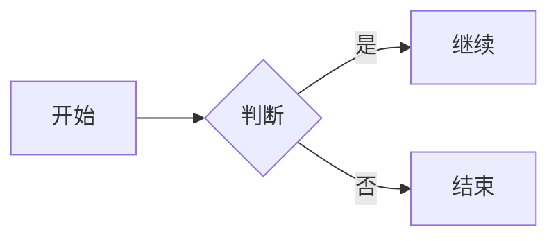

<!-- markdownlint-disable-file MD033 MD025 MD060 本文件是保真度测试夹具：故意包含 HTML、不对齐表格等构造，勿按 lint 规范修改内容 -->

# 中文一级标题 Heading

## 二级标题：带标点和 English 混排

正文段落，包含**中文加粗**、*斜体*、***粗斜体***、~~删除线~~、`行内代码`，以及转义 \*星号\* 的用法。

中文与**加粗**之间无空格的写法，还有 hard break：
第二行（上一行行尾两个空格）。

## 链接与图片

- [普通链接](https://example.com)
- [带标题的链接](https://example.com "示例标题")
- 自动链接：<https://example.com/auto>
- 图片：

## 代码

行内路径引用：`src/markdown/parser.ts:12` 与 ``含 ` 反引号的代码``。

```typescript
export function hello(name: string): string {
  return `你好, ${name}`;
}
```

~~~
波浪线围栏代码块
~~~

## 数学公式

行内公式 $E = mc^2$ 与 $a_1 + b_2 = c_3$。

$$
\int_{0}^{\infty} e^{-x^2} dx = \frac{\sqrt{\pi}}{2}
$$

## Mermaid 图表



## 表格

| 标签 | Session ID | 数值 | 备注 |
|:-----|:----------:|-----:|------|
| 默认 | 20c93f64-644c-4c58-a622-3e28c8e311ac | 42 | **含加粗** |
| 左对齐 | 居中内容 | 3.14 | `含代码` |

## 列表

1. 有序列表第一项
2. 有序列表第二项
   - 嵌套无序 A
   - 嵌套无序 B
3. 第三项

- [x] 已完成任务
- [ ] 未完成任务
- [ ] 带中文的[任务链接](https://example.com)

## 引用

> 一级引用文字
>
> > 嵌套引用
> >
> > - 引用中的列表
> > - 第二项

## 分隔线

---

## HTML 混合

包含内联 HTML：<kbd>Ctrl</kbd> + <kbd>C</kbd>。

<div class="custom-block">
  <p>HTML 块内容</p>
</div>

## 脚注与表情

这是一个脚注引用[^1]，以及表情短码 :smile: 和 :tada:。

[^1]: 脚注的正文内容，可以是**带格式**的。
